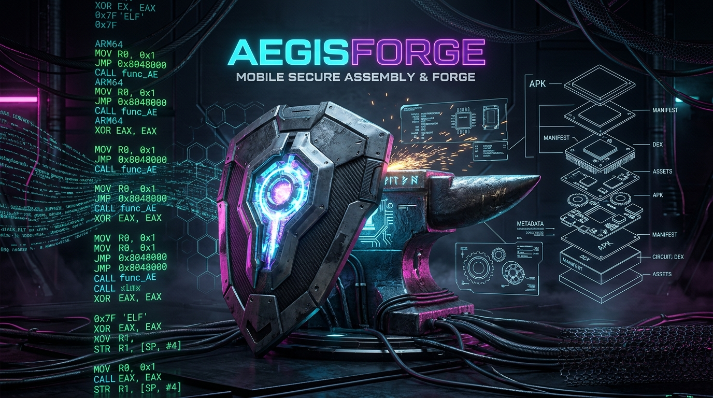
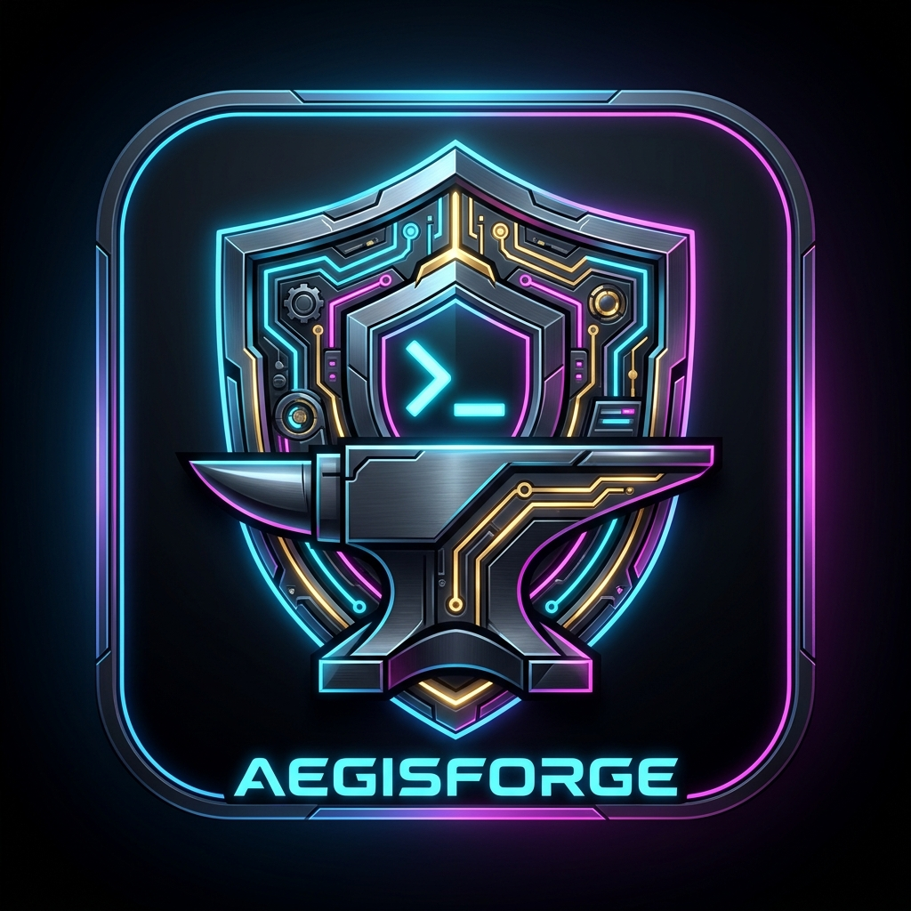

<div align="center">



<br/><br/>



# 🛡️ AegisForge
### Native Mobile Reverse Engineering & MCP Intelligence Suite for Termux (Android ARM64)

[](https://termux.dev/)
[](https://radare.org/)
[](https://github.com/skylot/jadx)
[](https://modelcontextprotocol.io/)
[](LICENSE)

[Características](#-características) • [Arquitectura](#-arquitectura) • [Instalación](#-instalación) • [Uso CLI](#-uso-cli) • [Skill & MCP Gateway](#-skill--mcp-gateway)

</div>

---

## 📌 ¿Qué es AegisForge?

**AegisForge** es la primera suite táctica de ingeniería inversa e inteligencia artificial para pentesting móvil que fusiona **Radare2**, **JADX**, **APKTool**, **REA** y **ADB** en un único ejecutable y servidor **MCP (Model Context Protocol)** 100% nativo para **Android ARM64 en Termux**.

Diseñado bajo la filosofía del ecosistema **i-Haklab** y el skill **termux-oracle**, elimina la necesidad de levantar modelos locales pesados (como Ollama) que congelan dispositivos móviles, permitiendo que agentes como `agy`, `jcode`, `termuxhivebear` y `AI-Haklab` auditen binarios y APKs en tiempo real con cero sobrecarga de RAM.

---

## 🚀 Características

- ⚡ **Radare2 / r2mcp Nativo:** Desensamblado ultra-rápido de binarios nativos ELF/SO y análisis de flujo de control (CFG).
- ☕ **JADX & APKTool Integrado:** Decompilación instantánea de paquetes APK y DEX a código fuente Java navegable y Smali.
- 🔬 **Motor REA Unificado:** Inspección multi-plataforma de bundles Web, empaquetados JavaScript/Electron y 168 comandos estáticos.
- 🤖 **Servidor MCP Nativo:** Gateway universal para asistentes IA (`agy`, Claude Code, Cursor, Copilot, etc.).
- 🌐 **Menú 3D Obsidian Neural:** Visualización galáctica interactiva para explorar herramientas y dependencias desde el navegador (`aegisforge menu`).

---

## 🏛️ Arquitectura

```
                  ┌──────────────────────────────────────────────┐
                  │          IA AGENTS (agy / AI-Haklab)         │
                  └──────────────────────┬───────────────────────┘
                                         │ (Protocolo MCP Stdio)
                                         ▼
                  ┌──────────────────────────────────────────────┐
                  │             AEGISFORGE GATEWAY               │
                  └───────┬──────────────┬──────────────┬────────┘
                          │              │              │
           ┌──────────────┴───┐   ┌──────┴──────┐   ┌───┴───────────────┐
           │     Radare2      │   │    JADX     │   │     REA Engine    │
           │ (Binarios C/ASM) │   │ (APK->Java) │   │ (JS & Web Bundles)│
           └──────────────────┘   └─────────────┘   └───────────────────┘
```

---

## 💻 Instalación Rápida en Termux

```bash
git clone https://github.com/kuromi04/AegisForge.git
cd AegisForge
chmod +x bin/aegisforge
# Enlazar comando global en Termux:
ln -sf $(pwd)/bin/aegisforge $PREFIX/bin/aegisforge
```

---

## 🛠️ Uso desde Terminal

AegisForge provee un CLI simple y directo:

```bash
# Ver versión y ayuda
aegisforge --help

# Desensamblar binario y listar funciones con Radare2
aegisforge r2 /ruta/al/binario "aaa; afl"

# Decompilar APK a código Java con JADX
aegisforge jadx mi_app.apk

# Desempaquetar APK a Smali y recursos con APKTool
aegisforge apktool mi_app.apk

# Abrir el menú galáctico 3D en el navegador
aegisforge menu

# Iniciar servidor MCP para agentes
aegisforge mcp
```

---

## 🤖 Integración MCP para Agentes

Añade el gateway en tu configuración MCP (`~/.gemini/settings.json` o equivalente):

```json
{
  "mcpServers": {
    "aegisforge": {
      "command": "aegisforge",
      "args": ["mcp"]
    }
  }
}
```

---

## 📜 Licencia & Autoría

- **Autor:** [@kuromi04](https://github.com/kuromi04)
- **Ecosistema:** Inspirado y optimizado para la comunidad **i-Haklab** de **Ivam3** y `termux-oracle`.
- Licencia MIT.
